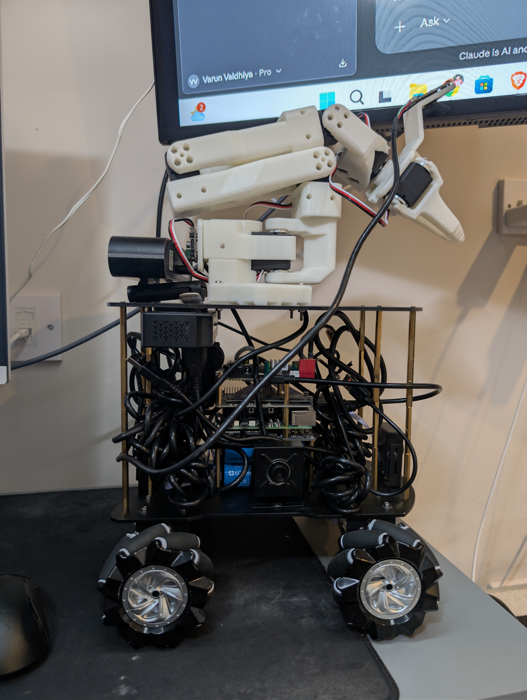
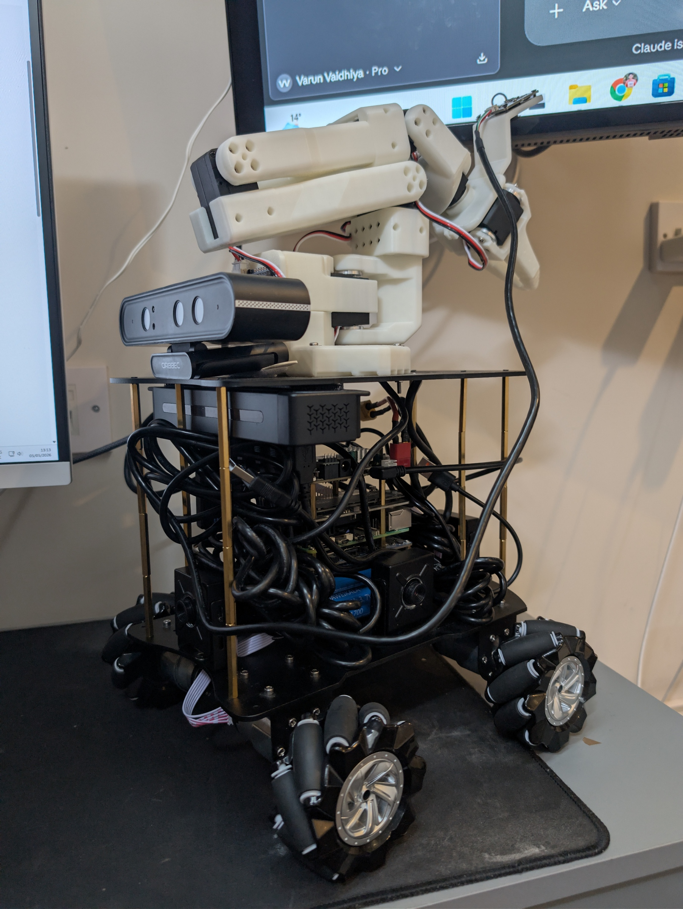
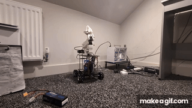
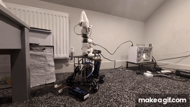
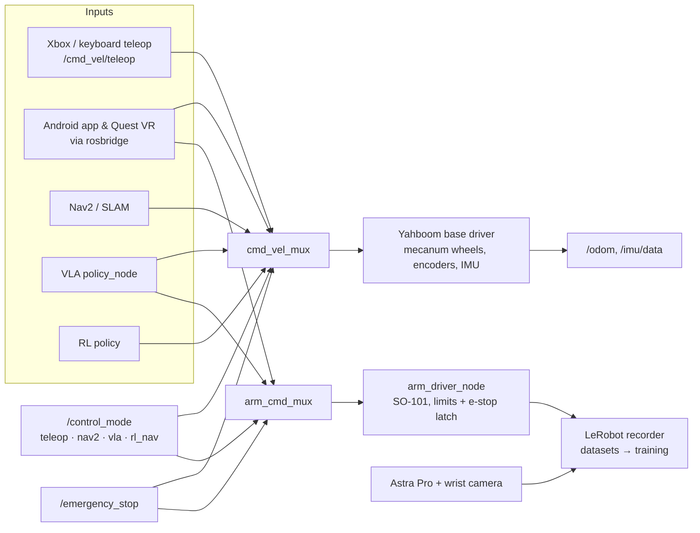

<div align="center">
  <h1>🤖 OmniBot: The OhhO Reference Architecture</h1>
  <p><strong>The official open-source mobile manipulation platform by OhhO Robotics</strong></p>

  <p align="center">
    
    
  </p>

  <p align="center">
    
    
  </p>

  <p align="center">
    <a href="https://www.youtube.com/@varun.vaidhiya/videos">
      
    </a>
    &nbsp;
    <a href="https://x.com/varunvaidhiya">
      
    </a>
    &nbsp;
    <a href="https://github.com/ohho-robotics/OmniBot/actions/workflows/ci.yml"></a>
    &nbsp;
    
    &nbsp;
    <a href="LICENSE"></a>
  </p>
</div>

<p align="center"><strong>An open-source ROS 2 Jazzy mobile manipulator (mecanum base + SO-101 arm) that you can run in simulation on a laptop in three commands, then build at home.</strong></p>

<p align="center">⭐ <strong>If OmniBot is useful or interesting to you, please star the repo</strong>: it helps other robotics people find it.</p>

## Why OmniBot

- **Full mobile-manipulation stack in one repo**: mecanum base driver and kinematics, SO-101 arm with e-stop and joint-limit safety, Nav2/SLAM, Gazebo Harmonic sim, and LeRobot data capture feeding VLA/RL policies.
- **Teleop from anywhere**: Xbox gamepad, Android app, Meta Quest VR, or the browser via rosbridge.
- **Honest and tested**: README commands run in CI. Anything that needs a robot or GPU is labelled as such in [docs/reference.md](docs/reference.md).

## Quickstart (no robot, no GPU)

[`ohho-os`](https://pypi.org/project/ohho-os/) is on PyPI under [Apache-2.0](https://github.com/ohho-robotics/ohho-os/blob/main/LICENSE). The docs-test job in [`.github/workflows/ci.yml`](.github/workflows/ci.yml) runs these three commands in a fresh virtualenv via [`scripts/docs_test_readme.py`](scripts/docs_test_readme.py).

<!-- docs-test: cpu -->
```bash
pip install ohho-os
ohho doctor
ohho sim --robot omnibot --seconds 2
```

## Build the ROS 2 workspace

Ubuntu 24.04 with ROS 2 Jazzy already installed. The symlinks in [`src/`](src/) are the colcon workspace. The `ros` CI job runs this block on `ros:jazzy-ros-base-noble`.

<!-- docs-test: skip ros -->
```bash
sudo apt-get update
sudo apt-get install -y python3-colcon-common-extensions python3-rosdep python3-pytest python3-pip
sudo rosdep init || true
rosdep update
source /opt/ros/jazzy/setup.bash
rosdep install --from-paths src --ignore-src -y --rosdistro jazzy \
  --dependency-types=build \
  --dependency-types=buildtool \
  --dependency-types=build_export \
  --dependency-types=buildtool_export \
  --dependency-types=exec \
  --dependency-types=test
colcon build --symlink-install --base-paths src
source install/setup.bash
colcon test --base-paths src --event-handlers console_direct+ --return-code-on-test-failure
colcon test-result --verbose
```

Then start the Gazebo sim with `ros2 launch omnibot_bringup sim.launch.py world:=flat`. That launch also drives the SO-101 arm, including the gripper, through `arm_sim_driver` using the joint limits and safety rules in [`omnibot_arm/config/arm_params.yaml`](omnibot-ros2/omnibot_arm/config/arm_params.yaml). See [docs/reference.md](docs/reference.md) for worlds, bridged topics and browser teleop.

On the physical robot (docs-test skips this):

<!-- docs-test: skip hardware -->
```bash
ros2 launch omnibot_bringup robot_with_joy.launch.py
ros2 launch omnibot_bringup perception.launch.py
ros2 launch omnibot_arm arm.launch.py
ros2 launch omnibot_lerobot teleop_record.launch.py
```

## Nav2 + slam_toolbox in Gazebo (OHH-30)

Simulation only. The apartment world from `sim.launch.py` is mapped with `slam_toolbox`, the saved map is checked in, and Nav2 (DWB) drives the holonomic base to the named waypoints `kitchen`, `desk`, and `door`. Nothing here was run on the real robot.

| Piece | Where |
|---|---|
| Mapping launch (`slam_toolbox`, headless Gazebo, scripted sweep) | [`sim_mapping.launch.py`](omnibot-ros2/omnibot_navigation/launch/sim_mapping.launch.py), [`sim_map_sweep.py`](omnibot-ros2/omnibot_navigation/scripts/sim_map_sweep.py) |
| Saved map and how to regenerate it | [`maps/`](omnibot-ros2/omnibot_navigation/maps/) (`apartment.yaml`, `apartment.pgm`, `apartment.posegraph`, `apartment.data`), [`maps/README.md`](omnibot-ros2/omnibot_navigation/maps/README.md), [`generate_sim_map.sh`](omnibot-ros2/omnibot_navigation/scripts/generate_sim_map.sh) |
| Named waypoints, map frame | [`config/waypoints.yaml`](omnibot-ros2/omnibot_navigation/config/waypoints.yaml), read by [`go_to_waypoint.py`](omnibot-ros2/omnibot_navigation/scripts/go_to_waypoint.py), [`waypoint_navigator.py`](omnibot-ros2/omnibot_navigation/scripts/waypoint_navigator.py), and the scenario test |
| Nav2 on the saved map | [`sim_navigation.launch.py`](omnibot-ros2/omnibot_navigation/launch/sim_navigation.launch.py), [`config/nav2_params.yaml`](omnibot-ros2/omnibot_navigation/config/nav2_params.yaml) |
| Integration test (kitchen within 60 s from the start pose; desk and door the same way) | [`test_nav_sim_scenarios.py`](omnibot-ros2/omnibot_navigation/test/test_nav_sim_scenarios.py), [`run_nav_scenarios.sh`](omnibot-ros2/omnibot_navigation/scripts/run_nav_scenarios.sh) |
| CI: 3 scenarios, nightly and `workflow_dispatch` | [`.github/workflows/nav-sim.yml`](.github/workflows/nav-sim.yml) |

The launch files and the scenario runner need ROS 2 Jazzy and Gazebo Harmonic, so docs-test skips them.

<!-- docs-test: skip ros -->
```bash
source /opt/ros/jazzy/setup.bash
source install/setup.bash
# Map the apartment with slam_toolbox (drives a fixed sweep, saves into maps/)
omnibot-ros2/omnibot_navigation/scripts/generate_sim_map.sh
# Nav2 on the saved map, then send the robot to a named waypoint
ros2 launch omnibot_navigation sim_navigation.launch.py
ros2 run omnibot_navigation go_to_waypoint.py kitchen
# The CI scenarios: a fresh sim per run, non-zero exit if any run fails
omnibot-ros2/omnibot_navigation/scripts/run_nav_scenarios.sh kitchen desk door
```

<p align="center">
  
</p>

The saved map with the start pose (yellow), `kitchen` (red), `desk` (blue), and `door` (green), drawn by [`render_map_overlay.py`](omnibot-ros2/omnibot_navigation/scripts/render_map_overlay.py). Grey is unknown space (inside the furniture and outside the walls).

### Time to goal

Each run starts a fresh headless Gazebo sim with the robot at the spawn pose (0, 0, yaw 0). Time is Gazebo simulation time from goal acceptance to Nav2 `SUCCEEDED`, with a 60 s limit. A run passes only if Nav2 succeeds in time **and** the final ground-truth pose (`/odom`, exact in the planar sim) is within 0.30 m and 0.50 rad of the waypoint. Nav2's own goal checker is tighter: 0.15 m and 0.20 rad.

| Scenario | Goal (map frame) | Runs | Passed | Time to goal, min / median / max (s) |
|---|---|---|---|---|
| `kitchen` | x -1.90, y 0.70, yaw 180 deg | 5 | 5 | 15.7 / 17.0 / 17.5 |
| `desk` | x 2.55, y -0.45, yaw 90 deg | 5 | 5 | 18.8 / 20.0 / 21.6 |
| `door` | x -0.30, y -1.45, yaw -90 deg | 5 | 5 | 8.2 / 12.8 / 13.4 |

Where these numbers come from: the 15 runs in [`nav_sim_runs_local.jsonl`](omnibot-ros2/omnibot_navigation/docs/nav_sim_runs_local.jsonl) and [`nav_sim_runs_local_log.txt`](omnibot-ros2/omnibot_navigation/docs/nav_sim_runs_local_log.txt), made with `run_nav_scenarios.sh --repeat 5 kitchen desk door` in a `ros:jazzy-ros-base-noble` Docker container (Mesa software rendering, 16 CPUs, real-time factor 1.0 in every run). They are local runs, not a GitHub Actions run. The [`nav-sim`](.github/workflows/nav-sim.yml) workflow produces the same table for each CI run in its job summary and artifacts; its nightly schedule runs each scenario 5 times in a row. Times on a CI runner may differ.

### Nav2 tuning for the mecanum base

Changes to [`nav2_params.yaml`](omnibot-ros2/omnibot_navigation/config/nav2_params.yaml), each of which the file now comments:

- DWB stays. The base is holonomic and DWB samples `vx`, `vy`, and `vtheta` (`vy_samples: 10`, `min_vel_y` -0.20, `max_vel_y` 0.20). `min_y_velocity_threshold` was 0.5, above `max_vel_y`, so the controller zeroed every lateral command. It is now 0.001. [`test_nav_assets.py`](omnibot-ros2/omnibot_navigation/test/test_nav_assets.py) fails if it goes back above `max_vel_y`.
- MPPI was not needed: 15 of 15 runs reached their goal in under 23 s with DWB once the lateral threshold above was fixed, so MPPI was not tried.
- Footprint is the 0.30 x 0.28 m rectangle around the 0.265 x 0.250 m chassis instead of a 0.22 m circle.
- Velocity caps stay at 0.20 m/s and 1.0 rad/s, the Yahboom driver clamp, so sim and robot limits match.
- Fixes needed to start on Jazzy at all: `nav2_amcl::OmniMotionModel` (the old class name does not exist), `nav2_navfn_planner::NavfnPlanner` (old `/` name not found), no `plugin_lib_names` list (it re-registers built-in BT nodes and crashes `bt_navigator`), a `behavior_server` section, and `slam_toolbox` launched as a lifecycle node (it stayed `unconfigured` before) with `map_file_name: ""` (the old `omnibot_map` made it fail to load a pose graph at start).

Not covered: `drive:=mecanum` (wheel-physics) with Nav2 was tried once and the `map` frame never appeared before Nav2's startup timeout, so `sim_navigation.launch.py` uses the planar holonomic drive only. The 3-D RTAB-Map stack, real-robot SLAM/Nav2, and bags are untouched.

GPU policy stacks (OmniVLA engine / OpenVLA / SmolVLA, Isaac Lab RL) need a desktop NVIDIA GPU, not the Raspberry Pi. The OmniVLA engine Python package is `vla_engine` ([README](omnibot-ai-engines/vla_engine/README.md)); CI runs its FastAPI tests with CPU torch.

<!-- docs-test: skip gpu -->
```bash
pip install -e "omnibot-ai-engines/vla_engine[serve,gpu]"
pip install -r omnibot-ai-engines/rl_engine/requirements.txt
```

## Replay a run (MCAP + Foxglove)

OmniBot records demo and telemetry runs into [MCAP](https://mcap.dev/) files via `rosbag2` with zstd compression, providing an honest 'Twin v0' replay and scrub capability without requiring proprietary simulators.

### Record a run

To record a run to MCAP:

<!-- docs-test: skip ros -->
```bash
ros2 launch omnibot_bringup record.launch.py
```

Options:
- `bag_path:=my_run`: Output directory / bag name (defaults to timestamped `rosbag2_YYYY_MM_DD-HH_mm_ss`).
- `use_sim_time:=true`: Timestamp using simulation `/clock`.
- `topics:="/tf /odom /scan ..."`: Override default topics.

Default recorded topics:
- `/tf`, `/tf_static`: Transform tree
- `/odom`: Robot odometry and twist
- `/scan`: 2D LaserScan
- `/camera/*`: Front, wrist, BEV, and depth camera streams
- `/agent/trace`, `/agent/loop_trace`: Agent loop decisions, tool calls, and verifier traces
- `/imu`, `/imu/data`: Linear acceleration and angular velocity
- `/rosout`: ROS logs

### Replay in Foxglove Studio

1. Open [Foxglove Studio](https://foxglove.dev/) (desktop app or [web app](https://app.foxglove.dev)).
2. Choose **Open local file** and select the `.mcap` file.
3. Import the checked-in layout: [`foxglove/omnibot_layout.json`](foxglove/omnibot_layout.json) (**Layout** &rarr; **Import from file...**).
4. Scrub the timeline to inspect the 3D scene (`/tf`, `/odom`, `/scan`), camera feeds, odometry/IMU plots, mission status, and agent execution trace.

Sample 30 s run MCAP: attached to GitHub releases (under 50 MB, replays directly in Foxglove Studio).

## Hardware (bill of materials)

These are the parts referenced in this repo's code and docs. Prices are not yet documented. Help fill them in via [#19](https://github.com/ohho-robotics/OmniBot/issues/19).

| Part | Qty | Where it is referenced | Approx. price |
|---|---|---|---|
| Mecanum chassis with 4 wheels (80 mm diameter, 0.215 m × 0.165 m wheel spacing) | 1 | [`mecanum-kinematics/config/mecanum_params.yaml`](mecanum-kinematics/config/mecanum_params.yaml) | TBD |
| Yahboom motor driver board (motors, wheel encoders, onboard IMU; USB serial 115200) | 1 | [`yahboom-python-driver/`](yahboom-python-driver/), [sensor guide](omnibot-ros2/omnibot_navigation/docs/SENSOR_INTEGRATION.md) | TBD |
| Raspberry Pi 5 (onboard compute) | 1 | [`omnibot_pi.launch.py`](omnibot-ros2/omnibot_bringup/launch/master/omnibot_pi.launch.py) | TBD |
| SO-101 arm (Feetech STS3215 servos) | 1 | [`omnibot-ros2/omnibot_arm/config/arm_params.yaml`](omnibot-ros2/omnibot_arm/config/arm_params.yaml), [meshes](omnibot-ros2/omnibot_description/meshes/so101/) | TBD |
| Orbbec Astra Pro RGB-D camera | 1 | [sensor guide](omnibot-ros2/omnibot_navigation/docs/SENSOR_INTEGRATION.md) | TBD |
| Wrist camera | 1 | [`perception.launch.py`](omnibot-ros2/omnibot_bringup/launch/perception.launch.py) | TBD |
| Xbox controller (teleop) | 1 | [`robot_with_joy.launch.py`](omnibot-ros2/omnibot_bringup/launch/robot_with_joy.launch.py) | TBD |
| Meta Quest 3 / 3S (optional VR teleop) | 0–1 | [`omnibot-vr/`](omnibot-vr/) | TBD |
| Desktop PC with NVIDIA GPU (optional, VLA/RL) | 0–1 | [`omnibot-ai-ros2/omnibot_vla/README.md`](omnibot-ai-ros2/omnibot_vla/README.md) | TBD |
| Battery, wiring, mounts | — | Not documented yet | TBD |

## Architecture

Full system diagram, launch graph, launch-derived topics table, and [known limitations](docs/architecture.md#known-limitations): **[docs/architecture.md](docs/architecture.md)**.



Details: control-mode gating in [docs/reference.md](docs/reference.md#bring-up-control-mode), arm and policy safety in [docs/safety.md](docs/safety.md). October pick-and-place fill-in: [docs/october-task.md](docs/october-task.md).

## Roadmap

- [ ] Nav2 + slam_toolbox in Gazebo with named waypoints (in review: [#18](https://github.com/ohho-robotics/OmniBot/pull/18))
- [ ] Hardware build guide and priced BOM ([#19](https://github.com/ohho-robotics/OmniBot/issues/19))
- [ ] MuJoCo backend for `mujoco.launch.py` ([#24](https://github.com/ohho-robotics/OmniBot/issues/24)); Isaac backend after that
- [ ] SO-100 arm support ([#26](https://github.com/ohho-robotics/OmniBot/issues/26))
- [ ] WebRTC video for the Quest client (MJPEG today)
- [ ] First tagged release, v0.1.0

## VR profile tag (not yet tagged)

The Quest client lives in [OhhO-VR](https://github.com/ohho-robotics/OhhO-VR), not in a second Unity tree on this commit. The Gazebo VR launch (`sim_vr.launch.py`), the real-robot VR launch (`robot_vr.launch.py`), and the GPU sim compose file are on other branches. They are not in `origin/main` (`d296c9be6cc898e11e8f671c2457292b30cec905`). The intended git tag is `vr-profile-v1.0.0`. It is not yet tagged. The intended sim image name `ghcr.io/ohho-robotics/omnibot-sim:vr-1.0.0` is a placeholder and is not published. Notes and the human commands: [CHANGELOG.md](CHANGELOG.md), [docs/releases/vr-profile-tag-commands.md](docs/releases/vr-profile-tag-commands.md).

## Contributing & community

New here? Pick a [**good first issue**](https://github.com/ohho-robotics/OmniBot/issues?q=is%3Aissue+is%3Aopen+label%3A%22good+first+issue%22) or a [**help wanted**](https://github.com/ohho-robotics/OmniBot/issues?q=is%3Aissue+is%3Aopen+label%3A%22help+wanted%22) issue. Questions, build photos and ideas go in [**Discussions**](https://github.com/ohho-robotics/OmniBot/discussions). Contribution guidelines and the code of conduct live in the [org `.github` repo](https://github.com/ohho-robotics/.github).

Demos and updates: [YouTube](https://www.youtube.com/@varun.vaidhiya/videos) · [X @varunvaidhiya](https://x.com/varunvaidhiya).

## Layout

| Directory | What it is |
|---|---|
| [`src/`](src/) | Colcon workspace (symlinks) |
| [`omnibot-ros2/`](omnibot-ros2/) | Driver, arm, description, bringup, Nav2 |
| [`omnibot-ai-ros2/`](omnibot-ai-ros2/) | VLA, LeRobot, RL, and orchestration nodes |
| [`omnibot-ai-engines/`](omnibot-ai-engines/) | Learning and agent engines, plus the GPU training trees |
| [`mecanum-kinematics/`](mecanum-kinematics/) | Wheel inverse and forward kinematics |
| [`yahboom-python-driver/`](yahboom-python-driver/) | Yahboom serial protocol |
| [`ros2-bev-stitcher/`](ros2-bev-stitcher/) | Bird's-eye homography |
| [`omnibot-digital-twin/`](omnibot-digital-twin/) | Gazebo world and compose files |
| [`omnibot-android/`](omnibot-android/) | Kotlin controller |
| [`omnibot-vr/`](omnibot-vr/) | Unity Quest project |

## License

[Apache-2.0](LICENSE) for OhhO code in this repository. Vendored Meta XR SDK and CoplayDev unity-mcp packages keep their own licences. See [NOTICE](NOTICE).

⭐ **Star the repo** to follow progress.
