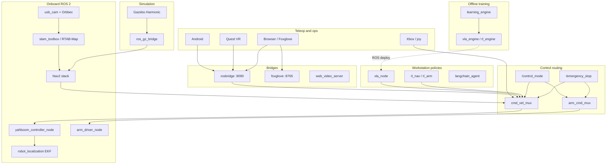
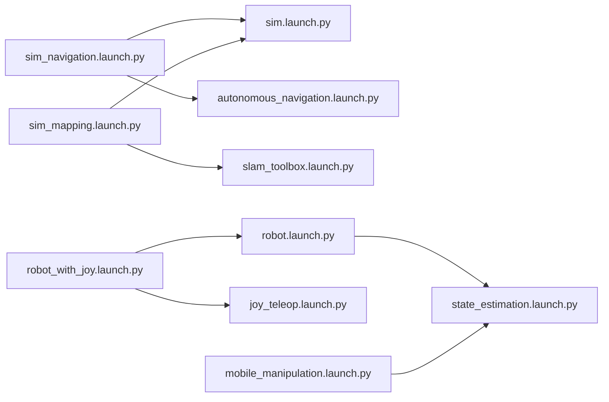

# OmniBot architecture

Back to [README](../README.md). Operational detail also lives in [reference.md](reference.md) and [safety.md](safety.md).

This document satisfies Linear OHH-43: system diagram, launch-derived topics table, launch graph, and known limitations. Every behavioural claim below links to source in this repository or to a CI workflow.

## System diagram

OmniBot is a ROS 2 Jazzy meta-repo: onboard drivers and perception on the Raspberry Pi ([`omnibot_pi.launch.py`](../omnibot-ros2/omnibot_bringup/launch/master/omnibot_pi.launch.py)), optional GPU policy nodes on a workstation ([`omnibot_workstation.launch.py`](../omnibot-ros2/omnibot_bringup/launch/master/omnibot_workstation.launch.py)), laptop simulation ([`sim.launch.py`](../omnibot-ros2/omnibot_bringup/launch/sim.launch.py)), and pure-Python libraries tested without ROS in [`.github/workflows/ci.yml`](../.github/workflows/ci.yml).



Control-mode gating is implemented in [`omnibot_hybrid`](../omnibot-ros2/omnibot_hybrid/) and documented in [reference.md § Bring-up control mode](reference.md#bring-up-control-mode). Arm safety limits are in [`omnibot_arm`](../omnibot-ros2/omnibot_arm/) and [safety.md](safety.md).

## Launch graph (common entry points)

Edges follow `IncludeLaunchDescription` in the launch sources (see generated table below).



| Entry command | Launch file | Typical use |
| --- | --- | --- |
| `ros2 launch omnibot_bringup sim.launch.py` | [`sim.launch.py`](../omnibot-ros2/omnibot_bringup/launch/sim.launch.py) | Headless Gazebo; CI [`sim-smoke`](../.github/workflows/ci.yml) |
| `ros2 launch omnibot_navigation sim_navigation.launch.py` | [`sim_navigation.launch.py`](../omnibot-ros2/omnibot_navigation/launch/sim_navigation.launch.py) | Nav2 in apartment sim; CI [`nav-sim`](../.github/workflows/nav-sim.yml) |
| `ros2 launch omnibot_bringup robot_with_joy.launch.py` | [`robot_with_joy.launch.py`](../omnibot-ros2/omnibot_bringup/launch/robot_with_joy.launch.py) | Physical base + Xbox teleop |
| `ros2 launch omnibot_bringup mobile_manipulation.launch.py` | [`mobile_manipulation.launch.py`](../omnibot-ros2/omnibot_bringup/launch/mobile_manipulation.launch.py) | Base mux + arm + cameras |
| `ros2 launch omnibot_bringup master/omnibot_pi.launch.py` | [`omnibot_pi.launch.py`](../omnibot-ros2/omnibot_bringup/launch/master/omnibot_pi.launch.py) | Full Pi stack (hardware) |

## Topics and services from launch files

<!-- BEGIN GENERATED_LAUNCH_TABLE -->
Tables below are generated by [`scripts/generate_architecture_launch_table.py`](../scripts/generate_architecture_launch_table.py). Do not edit manually; run the script and commit, or CI will fail.

### ROS nodes per launch file

| Launch file | `package` / `executable` | `name` | Includes |
| --- | --- | --- | --- |
| `omnibot-ai-ros2/omnibot_lerobot/launch/act_vr_sim_pick.launch.py` | - | - | `omnibot-ai-ros2/omnibot_lerobot/launch/policy_inference.launch.py` |
| `omnibot-ai-ros2/omnibot_lerobot/launch/lerobot_record.launch.py` | - | - | `omnibot-ai-ros2/omnibot_lerobot/launch/teleop_record.launch.py` |
| `omnibot-ai-ros2/omnibot_lerobot/launch/policy_inference.launch.py` | `omnibot_lerobot` / `policy_node` | `policy_node` | - |
|  | `omnibot_rl` / `arm_cmd_mux` | `arm_cmd_mux` |  |
| `omnibot-ai-ros2/omnibot_lerobot/launch/teleop_record.launch.py` | `omnibot_lerobot` / `teleop_recorder_node` | `teleop_recorder_node` | - |
| `omnibot-ai-ros2/omnibot_orchestration/launch/agent.launch.py` | `omnibot_orchestration` / `world_state_node` | `world_state_node` | - |
|  | `omnibot_orchestration` / `agent_node` | `agent_node` |  |
| `omnibot-ai-ros2/omnibot_orchestration/launch/agent_nav2.launch.py` | - | - | `omnibot-ai-ros2/omnibot_orchestration/launch/agent.launch.py` |
| `omnibot-ai-ros2/omnibot_orchestration/launch/langchain_agent.launch.py` | `omnibot_orchestration` / `langchain_agent_node` | `langchain_agent_node` | - |
| `omnibot-ai-ros2/omnibot_rl/launch/rl_inference.launch.py` | `omnibot_rl` / `rl_nav_node` | `rl_nav_node` | - |
|  | `omnibot_rl` / `rl_arm_node` | `rl_arm_node` |  |
|  | `omnibot_rl` / `arm_cmd_mux` | `arm_cmd_mux` |  |
|  | `omnibot_rl` / `rl_object_pose_node` | `rl_object_pose_node` |  |
| `omnibot-ai-ros2/omnibot_vla/launch/vla_desktop.launch.py` | `omnibot_vla` / `vla_node` | `vla_node` | - |
| `omnibot-ros2/omnibot_arm/launch/arm.launch.py` | `omnibot_arm` / `arm_driver_node.py` | `arm_driver_node` | - |
| `omnibot-ros2/omnibot_bringup/launch/bringup_with_xbox.launch.py` | - | - | `omnibot-ros2/omnibot_bringup/launch/robot.launch.py`, `omnibot-ros2/omnibot_bringup/launch/joy_teleop.launch.py` |
| `omnibot-ros2/omnibot_bringup/launch/display.launch.py` | `joint_state_publisher` / `joint_state_publisher` | - | - |
|  | `joint_state_publisher_gui` / `joint_state_publisher_gui` | - |  |
|  | `robot_state_publisher` / `robot_state_publisher` | - |  |
|  | `rviz2` / `rviz2` | `rviz2` |  |
| `omnibot-ros2/omnibot_bringup/launch/isaac.launch.py` | - | - | - |
| `omnibot-ros2/omnibot_bringup/launch/isaac_sim.launch.py` | `robot_state_publisher` / `robot_state_publisher` | - | - |
|  | `omnibot_lerobot` / `bev_stitcher_node.py` | `bev_stitcher_node` |  |
|  | `depthimage_to_laserscan` / `depthimage_to_laserscan_node` | `depthimage_to_laserscan` |  |
|  | `foxglove_bridge` / `foxglove_bridge` | `foxglove_bridge` |  |
|  | `rviz2` / `rviz2` | `rviz2` |  |
|  | `omnibot_arm` / `arm_driver_node.py` | `arm_driver_node` |  |
| `omnibot-ros2/omnibot_bringup/launch/joy_teleop.launch.py` | `joy` / `joy_node` | `joy_node` | - |
| `omnibot-ros2/omnibot_bringup/launch/master/omnibot_pi.launch.py` | `robot_state_publisher` / `robot_state_publisher` | - | - |
|  | `omnibot_driver` / `yahboom_controller_node.py` | `yahboom_controller_node` |  |
|  | `omnibot_perception` / `object_perception_node` | `object_perception_node` |  |
|  | `omnibot_hybrid` / `rosbag_recorder` | `rosbag_recorder` |  |
|  | `omnibot_arm` / `arm_driver_node.py` | `arm_driver_node` |  |
|  | `usb_cam` / `usb_cam_node_exe` | `usb_cam_front` |  |
|  | `usb_cam` / `usb_cam_node_exe` | `usb_cam_rear` |  |
|  | `usb_cam` / `usb_cam_node_exe` | `usb_cam_left` |  |
|  | `usb_cam` / `usb_cam_node_exe` | `usb_cam_right` |  |
|  | `usb_cam` / `usb_cam_node_exe` | `usb_cam_wrist` |  |
|  | `depthimage_to_laserscan` / `depthimage_to_laserscan_node` | `depthimage_to_laserscan` |  |
|  | `omnibot_lerobot` / `bev_stitcher_node.py` | `bev_stitcher_node` |  |
|  | `robot_localization` / `ekf_node` | `ekf_filter_node` |  |
|  | `slam_toolbox` / `async_slam_toolbox_node` | `slam_toolbox` |  |
|  | `rtabmap_slam` / `rtabmap` | `rtabmap` |  |
|  | `octomap_server` / `octomap_server_node` | `octomap_server` |  |
|  | `omnibot_hybrid` / `cmd_vel_mux` | `cmd_vel_mux` |  |
|  | `omnibot_rl` / `arm_cmd_mux` | `arm_cmd_mux` |  |
|  | `omnibot_hybrid` / `mission_planner` | `mission_planner` |  |
|  | `foxglove_bridge` / `foxglove_bridge` | `foxglove_bridge` |  |
|  | `web_video_server` / `web_video_server` | `web_video_server` |  |
|  | `rosbridge_server` / `rosbridge_websocket` | `rosbridge_websocket` |  |
| `omnibot-ros2/omnibot_bringup/launch/master/omnibot_workstation.launch.py` | `omnibot_vla` / `vla_node` | `vla_node` | - |
|  | `omnibot_lerobot` / `policy_node` | `smolvla_node` |  |
|  | `omnibot_rl` / `rl_nav_node` | `rl_nav_node` |  |
|  | `omnibot_rl` / `rl_arm_node` | `rl_arm_node` |  |
|  | `omnibot_rl` / `rl_object_pose_node` | `rl_object_pose_node` |  |
|  | `omnibot_orchestration` / `langchain_agent_node` | `langchain_agent_node` |  |
| `omnibot-ros2/omnibot_bringup/launch/mobile_manipulation.launch.py` | `omnibot_driver` / `yahboom_controller_node.py` | `yahboom_driver` | `omnibot-ros2/omnibot_bringup/launch/state_estimation.launch.py` |
|  | `omnibot_hybrid` / `cmd_vel_mux` | `cmd_vel_mux` |  |
|  | `robot_state_publisher` / `robot_state_publisher` | - |  |
|  | `omnibot_arm` / `arm_driver_node.py` | `arm_driver_node` |  |
|  | `omnibot_rl` / `arm_cmd_mux` | `arm_cmd_mux` |  |
|  | `usb_cam` / `usb_cam_node_exe` | `wrist_camera` |  |
|  | `orbbec_camera` / `orbbec_camera_node` | `orbbec_astra_pro` |  |
|  | `omnibot_lerobot` / `bev_stitcher_node` | `bev_stitcher_node` |  |
|  | `rosbridge_server` / `rosbridge_websocket` | `rosbridge_websocket` |  |
|  | `foxglove_bridge` / `foxglove_bridge` | `foxglove_bridge` |  |
|  | `usb_cam` / `usb_cam_node_exe` | - |  |
| `omnibot-ros2/omnibot_bringup/launch/mujoco.launch.py` | - | - | - |
| `omnibot-ros2/omnibot_bringup/launch/perception.launch.py` | `robot_state_publisher` / `robot_state_publisher` | - | - |
|  | `usb_cam` / `usb_cam_node_exe` | `usb_cam_front` |  |
|  | `usb_cam` / `usb_cam_node_exe` | `usb_cam_rear` |  |
|  | `usb_cam` / `usb_cam_node_exe` | `usb_cam_left` |  |
|  | `usb_cam` / `usb_cam_node_exe` | `usb_cam_right` |  |
|  | `usb_cam` / `usb_cam_node_exe` | `usb_cam_wrist` |  |
|  | `depthimage_to_laserscan` / `depthimage_to_laserscan_node` | `depthimage_to_laserscan` |  |
|  | `omnibot_lerobot` / `bev_stitcher_node.py` | `bev_stitcher_node` |  |
|  | `rviz2` / `rviz2` | `rviz2` |  |
|  | `omnibot_perception` / `object_perception_node` | `object_perception_node` |  |
|  | `foxglove_bridge` / `foxglove_bridge` | `foxglove_bridge` |  |
|  | `web_video_server` / `web_video_server` | `web_video_server` |  |
| `omnibot-ros2/omnibot_bringup/launch/perception_viewer.launch.py` | `rviz2` / `rviz2` | `rviz2` | - |
| `omnibot-ros2/omnibot_bringup/launch/record.launch.py` | - | - | - |
| `omnibot-ros2/omnibot_bringup/launch/robot.launch.py` | `omnibot_driver` / `yahboom_controller_node.py` | `yahboom_driver` | `omnibot-ros2/omnibot_bringup/launch/state_estimation.launch.py` |
|  | `omnibot_driver` / `yahboom_controller_node.py` | `yahboom_driver` |  |
|  | `robot_state_publisher` / `robot_state_publisher` | - |  |
|  | `rosbridge_server` / `rosbridge_websocket` | `rosbridge_websocket` |  |
|  | `foxglove_bridge` / `foxglove_bridge` | `foxglove_bridge` |  |
|  | `omnibot_metrics` / `metrics_bridge` | `ros2_prometheus_bridge` |  |
|  | `omnibot_bringup` / `descriptor_node.py` | `ohho_descriptor` |  |
|  | `omnibot_ota` / `ota_agent` | `ota_agent_node` |  |
| `omnibot-ros2/omnibot_bringup/launch/robot_with_joy.launch.py` | - | - | `omnibot-ros2/omnibot_bringup/launch/robot.launch.py`, `omnibot-ros2/omnibot_bringup/launch/joy_teleop.launch.py` |
| `omnibot-ros2/omnibot_bringup/launch/sim.launch.py` | `robot_state_publisher` / `robot_state_publisher` | - | `omnibot-ros2/omnibot_bringup/launch/sim_cameras.launch.py` |
|  | `ros_gz_bridge` / `parameter_bridge` | `ros_gz_bridge` |  |
|  | `omnibot_bringup` / `descriptor_node.py` | `ohho_descriptor` |  |
|  | `omnibot_arm` / `arm_sim_driver_node.py` | `arm_sim_driver_node` |  |
|  | `rosbridge_server` / `rosbridge_websocket` | `rosbridge_websocket` |  |
|  | `ros_gz_sim` / `create` | - |  |
| `omnibot-ros2/omnibot_bringup/launch/sim_cameras.launch.py` | `ros_gz_bridge` / `parameter_bridge` | `ros_gz_camera_bridge` | - |
|  | `web_video_server` / `web_video_server` | `web_video_server` |  |
| `omnibot-ros2/omnibot_bringup/launch/sim_pc.launch.py` | `omnibot_lerobot` / `bev_stitcher_node.py` | `bev_stitcher_node` | - |
|  | `rviz2` / `rviz2` | `rviz2` |  |
| `omnibot-ros2/omnibot_bringup/launch/simulation.launch.py` | `robot_state_publisher` / `robot_state_publisher` | - | - |
|  | `ros_gz_bridge` / `parameter_bridge` | - |  |
|  | `topic_tools` / `relay` | `arm_joint_state_relay` |  |
|  | `depthimage_to_laserscan` / `depthimage_to_laserscan_node` | `depthimage_to_laserscan` |  |
|  | `web_video_server` / `web_video_server` | `web_video_server` |  |
|  | `rosbridge_server` / `rosbridge_websocket` | `rosbridge_websocket` |  |
|  | `foxglove_bridge` / `foxglove_bridge` | `foxglove_bridge` |  |
|  | `rviz2` / `rviz2` | `rviz2` |  |
|  | `ros_gz_sim` / `create` | - |  |
|  | `omnibot_arm` / `arm_driver_node.py` | `arm_driver_node` |  |
|  | `omnibot_lerobot` / `bev_stitcher_node` | `bev_stitcher_node` |  |
| `omnibot-ros2/omnibot_bringup/launch/slam_3d_mapping.launch.py` | `slam_toolbox` / `async_slam_toolbox_node` | `slam_toolbox` | - |
|  | `rtabmap_slam` / `rtabmap` | `rtabmap` |  |
|  | `octomap_server` / `octomap_server_node` | `octomap_server` |  |
|  | `rviz2` / `rviz2` | `rviz2` |  |
| `omnibot-ros2/omnibot_bringup/launch/slam_3d_viewer.launch.py` | `rviz2` / `rviz2` | `rviz2` | - |
| `omnibot-ros2/omnibot_bringup/launch/state_estimation.launch.py` | `robot_localization` / `ekf_node` | `ekf_filter_node` | - |
| `omnibot-ros2/omnibot_driver/launch/base_control.launch.py` | `omnibot_driver` / `serial_bridge_node.py` | `serial_bridge_node` | - |
|  | `omnibot_driver` / `mecanum_controller_node.py` | `mecanum_controller_node` |  |
| `omnibot-ros2/omnibot_driver/launch/yahboom_base_control.launch.py` | `omnibot_driver` / `yahboom_controller_node.py` | `yahboom_controller_node` | - |
|  | `robot_state_publisher` / `robot_state_publisher` | `robot_state_publisher` |  |
| `omnibot-ros2/omnibot_driver/launch/yahboom_test.launch.py` | `omnibot_driver` / `yahboom_test_node.py` | `yahboom_test_node` | - |
| `omnibot-ros2/omnibot_hybrid/launch/hybrid_robot.launch.py` | `omnibot_driver` / `yahboom_controller_node.py` | `yahboom_driver` | - |
|  | `omnibot_hybrid` / `rosbag_recorder` | `rosbag_recorder` |  |
|  | `omnibot_rl` / `arm_cmd_mux` | `arm_cmd_mux` |  |
|  | `robot_state_publisher` / `robot_state_publisher` | - |  |
|  | `robot_localization` / `ekf_node` | `ekf_filter_node` |  |
|  | `omnibot_vla` / `vla_node` | `vla_node` |  |
|  | `omnibot_hybrid` / `cmd_vel_mux` | `cmd_vel_mux` |  |
|  | `omnibot_hybrid` / `mission_planner` | `mission_planner` |  |
|  | `omnibot_lerobot` / `bev_stitcher_node` | `bev_stitcher_node` |  |
|  | `rosbridge_server` / `rosbridge_websocket` | `rosbridge_websocket` |  |
|  | `foxglove_bridge` / `foxglove_bridge` | `foxglove_bridge` |  |
|  | `rviz2` / `rviz2` | `rviz2` |  |
|  | `omnibot_ota` / `ota_agent` | `ota_agent_node` |  |
| `omnibot-ros2/omnibot_navigation/launch/autonomous_navigation.launch.py` | `nav2_controller` / `controller_server` | - | - |
|  | `nav2_planner` / `planner_server` | `planner_server` |  |
|  | `nav2_behaviors` / `behavior_server` | - |  |
|  | `nav2_bt_navigator` / `bt_navigator` | `bt_navigator` |  |
|  | `nav2_velocity_smoother` / `velocity_smoother` | `velocity_smoother` |  |
|  | `nav2_lifecycle_manager` / `lifecycle_manager` | `lifecycle_manager_navigation` |  |
| `omnibot-ros2/omnibot_navigation/launch/autonomous_robot.launch.py` | `rviz2` / `rviz2` | `rviz2` | `omnibot-ros2/omnibot_navigation/launch/rtabmap.launch.py`, `omnibot-ros2/omnibot_navigation/launch/slam_toolbox.launch.py`, `omnibot-ros2/omnibot_navigation/launch/autonomous_navigation.launch.py` |
| `omnibot-ros2/omnibot_navigation/launch/autonomous_with_waypoints.launch.py` | `omnibot_navigation` / `waypoint_navigator.py` | `waypoint_navigator` | `omnibot-ros2/omnibot_navigation/launch/autonomous_robot.launch.py` |
| `omnibot-ros2/omnibot_navigation/launch/rtabmap.launch.py` | `astra_camera` / `astra_camera_node` | `astra_camera` | - |
|  | `rtabmap_ros` / `rtabmap` | `rtabmap` |  |
|  | `octomap_server` / `octomap_server_node` | `octomap_server` |  |
| `omnibot-ros2/omnibot_navigation/launch/sim_mapping.launch.py` | `omnibot_navigation` / `sim_map_sweep.py` | `sim_map_sweep` | `omnibot-ros2/omnibot_navigation/launch/slam_toolbox.launch.py` |
| `omnibot-ros2/omnibot_navigation/launch/sim_navigation.launch.py` | `nav2_map_server` / `map_server` | `map_server` | `omnibot-ros2/omnibot_navigation/launch/autonomous_navigation.launch.py` |
|  | `nav2_amcl` / `amcl` | `amcl` |  |
|  | `nav2_lifecycle_manager` / `lifecycle_manager` | `lifecycle_manager_localization` |  |
|  | `foxglove_bridge` / `foxglove_bridge` | `foxglove_bridge` |  |
|  | `omnibot_navigation` / `waypoint_navigator.py` | `waypoint_navigator` |  |
| `omnibot-ros2/omnibot_navigation/launch/slam_toolbox.launch.py` | - | - | - |
| `ros2-bev-stitcher/launch/bev_stitcher.launch.py` | `ros2_bev_stitcher` / `bev_stitcher` | `bev_stitcher` | - |
| `yahboom-python-driver/launch/yahboom_driver.launch.py` | `yahboom_ros2` / `yahboom_driver` | `yahboom_driver` | - |

### Bridged topics (`ros_gz_bridge` YAML)

| Config file | ROS topic | Message type |
| --- | --- | --- |
| `omnibot-ros2/omnibot_bringup/config/ros_gz_bridge.yaml` | `/camera/camera_info` | `sensor_msgs/msg/CameraInfo` |
| `omnibot-ros2/omnibot_bringup/config/ros_gz_bridge.yaml` | `/camera/color/camera_info` | `sensor_msgs/msg/CameraInfo` |
| `omnibot-ros2/omnibot_bringup/config/ros_gz_bridge.yaml` | `/camera/color/image_raw` | `sensor_msgs/msg/Image` |
| `omnibot-ros2/omnibot_bringup/config/ros_gz_bridge.yaml` | `/camera/depth/camera_info` | `sensor_msgs/msg/CameraInfo` |
| `omnibot-ros2/omnibot_bringup/config/ros_gz_bridge.yaml` | `/camera/depth/image_raw` | `sensor_msgs/msg/Image` |
| `omnibot-ros2/omnibot_bringup/config/ros_gz_bridge.yaml` | `/camera/depth/points` | `sensor_msgs/msg/PointCloud2` |
| `omnibot-ros2/omnibot_bringup/config/ros_gz_bridge.yaml` | `/camera/front/image_raw` | `sensor_msgs/msg/Image` |
| `omnibot-ros2/omnibot_bringup/config/ros_gz_bridge.yaml` | `/camera/image_raw` | `sensor_msgs/msg/Image` |
| `omnibot-ros2/omnibot_bringup/config/ros_gz_bridge.yaml` | `/camera/left/image_raw` | `sensor_msgs/msg/Image` |
| `omnibot-ros2/omnibot_bringup/config/ros_gz_bridge.yaml` | `/camera/rear/image_raw` | `sensor_msgs/msg/Image` |
| `omnibot-ros2/omnibot_bringup/config/ros_gz_bridge.yaml` | `/camera/right/image_raw` | `sensor_msgs/msg/Image` |
| `omnibot-ros2/omnibot_bringup/config/ros_gz_bridge.yaml` | `/clock` | `rosgraph_msgs/msg/Clock` |
| `omnibot-ros2/omnibot_bringup/config/ros_gz_bridge.yaml` | `/cmd_vel` | `geometry_msgs/msg/Twist` |
| `omnibot-ros2/omnibot_bringup/config/ros_gz_bridge.yaml` | `/imu/data` | `sensor_msgs/msg/Imu` |
| `omnibot-ros2/omnibot_bringup/config/ros_gz_bridge.yaml` | `/joint_states` | `sensor_msgs/msg/JointState` |
| `omnibot-ros2/omnibot_bringup/config/ros_gz_bridge.yaml` | `/odom` | `nav_msgs/msg/Odometry` |
| `omnibot-ros2/omnibot_bringup/config/ros_gz_bridge.yaml` | `/tf` | `tf2_msgs/msg/TFMessage` |
| `omnibot-ros2/omnibot_bringup/config/sim_bridge.yaml` | `/arm/sim/arm_elbow_flex/cmd_pos` | `std_msgs/msg/Float64` |
| `omnibot-ros2/omnibot_bringup/config/sim_bridge.yaml` | `/arm/sim/arm_gripper/cmd_pos` | `std_msgs/msg/Float64` |
| `omnibot-ros2/omnibot_bringup/config/sim_bridge.yaml` | `/arm/sim/arm_shoulder_lift/cmd_pos` | `std_msgs/msg/Float64` |
| `omnibot-ros2/omnibot_bringup/config/sim_bridge.yaml` | `/arm/sim/arm_shoulder_pan/cmd_pos` | `std_msgs/msg/Float64` |
| `omnibot-ros2/omnibot_bringup/config/sim_bridge.yaml` | `/arm/sim/arm_wrist_flex/cmd_pos` | `std_msgs/msg/Float64` |
| `omnibot-ros2/omnibot_bringup/config/sim_bridge.yaml` | `/arm/sim/arm_wrist_roll/cmd_pos` | `std_msgs/msg/Float64` |
| `omnibot-ros2/omnibot_bringup/config/sim_bridge.yaml` | `/arm/sim/joint_states` | `sensor_msgs/msg/JointState` |
| `omnibot-ros2/omnibot_bringup/config/sim_bridge.yaml` | `/camera/front/camera_info` | `sensor_msgs/msg/CameraInfo` |
| `omnibot-ros2/omnibot_bringup/config/sim_bridge.yaml` | `/camera/front/image_raw` | `sensor_msgs/msg/Image` |
| `omnibot-ros2/omnibot_bringup/config/sim_bridge.yaml` | `/clock` | `rosgraph_msgs/msg/Clock` |
| `omnibot-ros2/omnibot_bringup/config/sim_bridge.yaml` | `/cmd_vel` | `geometry_msgs/msg/Twist` |
| `omnibot-ros2/omnibot_bringup/config/sim_bridge.yaml` | `/imu` | `sensor_msgs/msg/Imu` |
| `omnibot-ros2/omnibot_bringup/config/sim_bridge.yaml` | `/odom` | `nav_msgs/msg/Odometry` |
| `omnibot-ros2/omnibot_bringup/config/sim_bridge.yaml` | `/scan` | `sensor_msgs/msg/LaserScan` |
| `omnibot-ros2/omnibot_bringup/config/sim_bridge.yaml` | `/tf` | `tf2_msgs/msg/TFMessage` |
| `omnibot-ros2/omnibot_bringup/config/sim_bridge_cameras.yaml` | `/camera/base/bev/camera_info` | `sensor_msgs/msg/CameraInfo` |
| `omnibot-ros2/omnibot_bringup/config/sim_bridge_cameras.yaml` | `/camera/base/bev/image_raw` | `sensor_msgs/msg/Image` |
| `omnibot-ros2/omnibot_bringup/config/sim_bridge_cameras.yaml` | `/camera/wrist/camera_info` | `sensor_msgs/msg/CameraInfo` |
| `omnibot-ros2/omnibot_bringup/config/sim_bridge_cameras.yaml` | `/camera/wrist/image_raw` | `sensor_msgs/msg/Image` |
| `omnibot-ros2/omnibot_bringup/config/sim_bridge_cameras.yaml` | `/sim/chase_cam/camera_info` | `sensor_msgs/msg/CameraInfo` |
| `omnibot-ros2/omnibot_bringup/config/sim_bridge_cameras.yaml` | `/sim/chase_cam/image_raw` | `sensor_msgs/msg/Image` |

### Selected topic remappings in launch source

Nav2 and the mobile-manipulation stack rename `/cmd_vel` at the mux boundary. See [`docs/reference.md`](../docs/reference.md#bring-up-control-mode).

| Launch file | From | To |
| --- | --- | --- |
| `omnibot-ai-ros2/omnibot_lerobot/launch/policy_inference.launch.py` | `/cmd_vel` | `/cmd_vel/vla` |
| `omnibot-ros2/omnibot_bringup/launch/isaac_sim.launch.py` | `/arm/joint_states` | `/joint_states` |
|  | `/arm/joint_commands/out` | `/arm/joint_commands` |
|  | `depth` | `/camera/depth/image_raw` |
|  | `depth_camera_info` | `/camera/depth/camera_info` |
|  | `scan` | `/scan` |
| `omnibot-ros2/omnibot_bringup/launch/master/omnibot_pi.launch.py` | `cmd_vel` | `/cmd_vel/out` |
|  | `joint_commands` | `/arm/joint_commands/out` |
|  | `depth` | `/camera/depth/image_raw` |
|  | `depth_camera_info` | `/camera/depth/camera_info` |
|  | `scan` | `/scan` |
|  | `odometry/filtered` | `/odometry/filtered` |
|  | `rgb/image` | `/camera/color/image_raw` |
|  | `rgb/camera_info` | `/camera/color/camera_info` |
|  | `depth/image` | `/camera/depth/image_raw` |
|  | `depth/camera_info` | `/camera/depth/camera_info` |
|  | `odom` | `/odometry/filtered` |
|  | `grid_map` | `/rtabmap/grid_map` |
|  | `cloud_in` | `/rtabmap/cloud_map` |
| `omnibot-ros2/omnibot_bringup/launch/master/omnibot_workstation.launch.py` | `/image_raw` | `/camera/front/image_raw` |
| `omnibot-ros2/omnibot_bringup/launch/mobile_manipulation.launch.py` | `/cmd_vel` | `/cmd_vel/out` |
|  | `image_raw` | `/camera/wrist/image_raw` |
|  | `camera_info` | `/camera/wrist/camera_info` |
|  | `depth/image_raw` | `/camera/depth/image_raw` |
|  | `depth/camera_info` | `/camera/depth/camera_info` |
|  | `color/image_raw` | `/camera/depth/color/image_raw` |
|  | `depth/points` | `/camera/depth/points` |
| `omnibot-ros2/omnibot_bringup/launch/perception.launch.py` | `depth` | `/camera/depth/image_raw` |
|  | `depth_camera_info` | `/camera/depth/camera_info` |
|  | `scan` | `/scan` |
| `omnibot-ros2/omnibot_bringup/launch/simulation.launch.py` | `depth` | `/camera/depth/image_raw` |
|  | `depth_camera_info` | `/camera/depth/camera_info` |
|  | `scan` | `/scan` |
| `omnibot-ros2/omnibot_bringup/launch/slam_3d_mapping.launch.py` | `rgb/image` | `/camera/color/image_raw` |
|  | `rgb/camera_info` | `/camera/color/camera_info` |
|  | `depth/image` | `/camera/depth/image_raw` |
|  | `depth/camera_info` | `/camera/depth/camera_info` |
|  | `odom` | `/odometry/filtered` |
|  | `grid_map` | `/rtabmap/grid_map` |
|  | `cloud_in` | `/rtabmap/cloud_map` |
| `omnibot-ros2/omnibot_bringup/launch/state_estimation.launch.py` | `odometry/filtered` | `/odometry/filtered` |
| `omnibot-ros2/omnibot_driver/launch/yahboom_base_control.launch.py` | `cmd_vel` | `cmd_vel` |
|  | `odom` | `odom` |
| `omnibot-ros2/omnibot_hybrid/launch/hybrid_robot.launch.py` | `/cmd_vel` | `/cmd_vel/out` |
| `omnibot-ros2/omnibot_navigation/launch/autonomous_navigation.launch.py` | `cmd_vel` | `/cmd_vel_nav2_raw` |
|  | `cmd_vel` | `/cmd_vel_nav2_raw` |
|  | `cmd_vel` | `/cmd_vel_nav2_raw` |
|  | `cmd_vel_smoothed` | `/cmd_vel` |
| `omnibot-ros2/omnibot_navigation/launch/rtabmap.launch.py` | `rgb/image` | `/camera/color/image_raw` |
|  | `rgb/camera_info` | `/camera/color/camera_info` |
|  | `depth/image` | `/camera/depth/image_raw` |
|  | `depth/camera_info` | `/camera/depth/camera_info` |
|  | `odom` | `/odom` |
|  | `grid_map` | `/rtabmap/grid_map` |
|  | `cloud_in` | `/rtabmap/cloud_map` |
<!-- END GENERATED_LAUNCH_TABLE -->
ROS 2 services are created inside node implementations, not declared in launch files; this table lists nodes and bridged topics only. Nav2 action servers (for example `NavigateToPose`) come from [`autonomous_navigation.launch.py`](../omnibot-ros2/omnibot_navigation/launch/autonomous_navigation.launch.py).

## Known limitations

Honest gaps as of this branch; each item points at code or CI scope.

| Limitation | Evidence |
| --- | --- |
| MuJoCo and Isaac Sim launch backends are stubs (`not built`, exit 2). | [`mujoco.launch.py`](../omnibot-ros2/omnibot_bringup/launch/mujoco.launch.py), [`isaac.launch.py`](../omnibot-ros2/omnibot_bringup/launch/isaac.launch.py), [`test_unbuilt_launch.py`](../omnibot-ros2/omnibot_bringup/test/test_unbuilt_launch.py) |
| `sim_navigation.launch.py` uses planar holonomic drive only; `drive:=mecanum` with Nav2 did not produce `map` before startup timeout. | Comment in [`sim_navigation.launch.py`](../omnibot-ros2/omnibot_navigation/launch/sim_navigation.launch.py), [README Nav2 section](../README.md#nav2-tuning-for-the-mecanum-base) |
| Nav2 + `slam_toolbox` waypoint runs are simulation-only; not validated on the physical robot. | [README](../README.md#nav2--slam_toolbox-in-gazebo-ohh-30), [reference.md](reference.md) |
| OpenVLA / SmolVLA and Isaac Lab RL need a desktop NVIDIA GPU; not installed in CPU CI. | [`vla_engine/requirements.txt`](../omnibot-ai-engines/vla_engine/requirements.txt), [`rl_engine/requirements.txt`](../omnibot-ai-engines/rl_engine/requirements.txt), [reference.md](reference.md) |
| `omnibot-digital-twin` compose references a missing sim Dockerfile / install path. | [`docker-compose.yml`](../omnibot-digital-twin/docker/docker-compose.yml), [AGENTS.md](../AGENTS.md) |
| rosbridge defaults to loopback; `rosbridge_address:=0.0.0.0` exposes an unauthenticated WebSocket. | [`sim.launch.py`](../omnibot-ros2/omnibot_bringup/launch/sim.launch.py) docstring and arguments |
| Quest client uses MJPEG via `web_video_server`; WebRTC is roadmap-only. | [README roadmap](../README.md#roadmap) |
| BOM prices and some mounts are not documented. | [README hardware table](../README.md#hardware-bill-of-materials), issue [#19](https://github.com/ohho-robotics/OmniBot/issues/19) |
| Launch table parser reads static Python launch sources; dynamic `OpaqueFunction` node lists may be incomplete. | [`scripts/generate_architecture_launch_table.py`](../scripts/generate_architecture_launch_table.py) |

## Regenerating the launch table

```bash
python scripts/generate_architecture_launch_table.py
python scripts/generate_architecture_launch_table.py --write-doc
```

CI runs [`scripts/test_architecture_launch_table.py`](../scripts/test_architecture_launch_table.py) in the CPU job ([`ci.yml`](../.github/workflows/ci.yml)).
